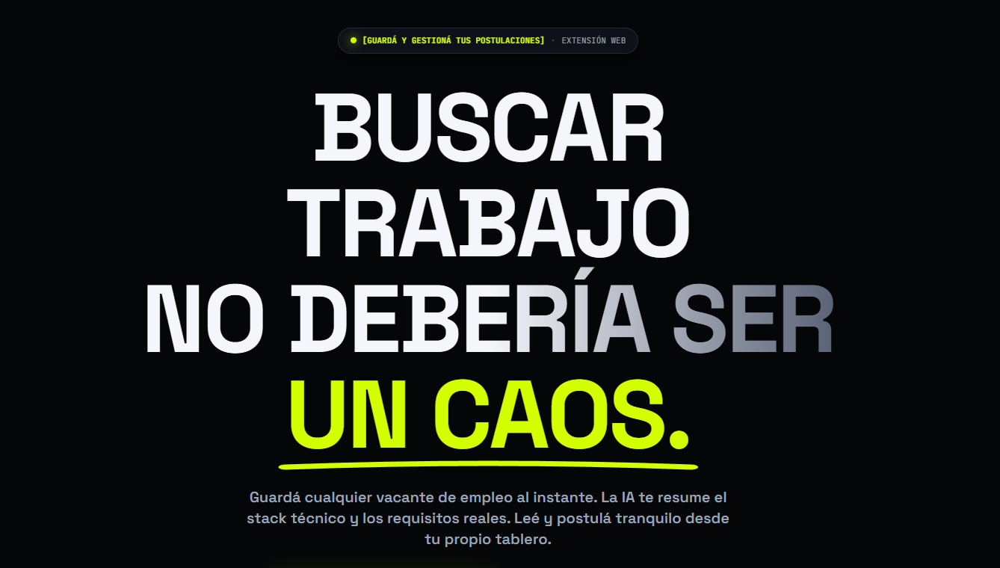
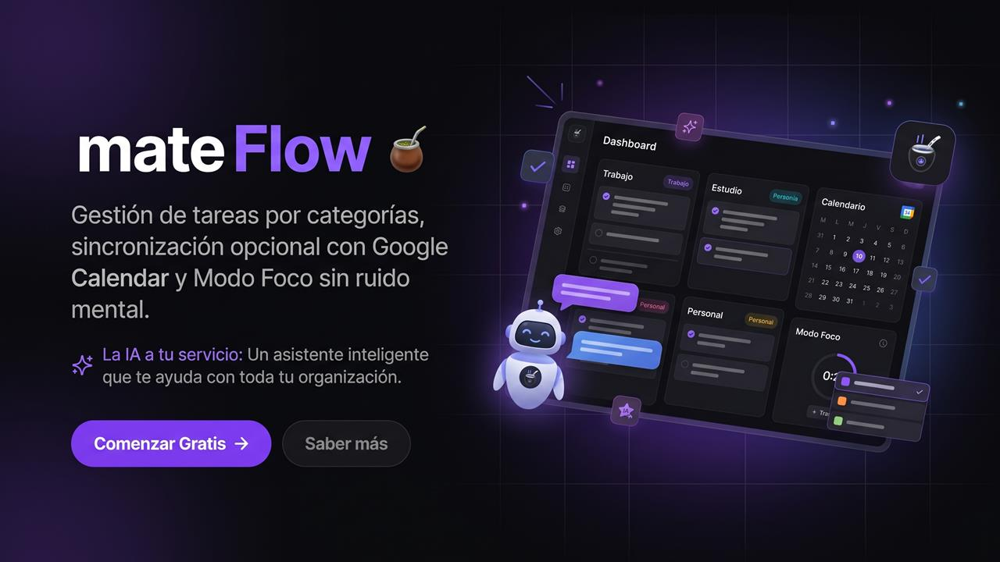
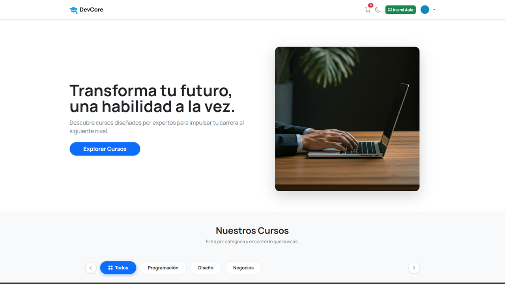
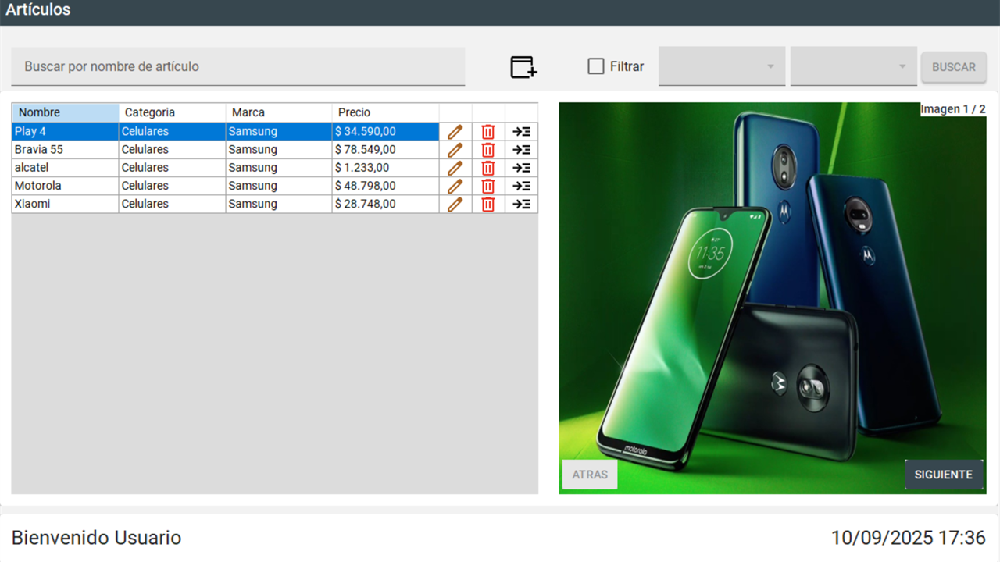

  
  
  
  

# Sebastián Duarte — Backend .NET & AI Solutions Developer

Especializado en el diseño y desarrollo de **APIs RESTful, arquitecturas en capas (N-Tier / Clean Architecture) y sistemas transaccionales en el ecosistema .NET (C#, ASP.NET Core, Entity Framework Core, ADO.NET)** sobre motores relacionales (**SQL Server** y **PostgreSQL**), integrando modelos de **Inteligencia Artificial (Google Gemini API)** en productos reales en producción.

- **🏗️ Arquitectura Backend & Datos (.NET):** Diseño de sistemas desacoplados, modelado relacional y optimización de consultas en **SQL Server** y **PostgreSQL** (*Stored Procedures*, *Triggers*, *Row Level Security* y transacciones).
- **🧠 IA Aplicada en Producción:** Orquestación de **Google Gemini API** en backends propios (**SearchingWork** y **MateFlow**) mediante agentes con *Function Calling*, extracción estructurada (*JSON Schema*) y cascadas de modelos tolerantes a fallos.
- **👨‍🏫 Criterio Técnico & Docencia:** Desarrollador Backend freelance, **Code Reviewer C#/.NET** en **MaxiPrograma** y **Ayudante de Cátedra** de Programación I en **UTN - FRGP**.
- **🎓 Doble Formación Universitaria:** Graduado como **Técnico Universitario en Desarrollo Web (UNER)** y **Tecnicatura Universitaria en Programación (UTN - FRGP)** con el 100% de la cursada aprobada (TFI en curso).

---

### 🛠️ Stack Principal (.NET, Datos & IA)

| Especialidad | Tecnologías y Herramientas de Producción |
| :--- | :--- |
| **Ecosistema .NET** |        |
| **Bases de Datos** | -CC2927?style=flat-square&logo=microsoftsqlserver&logoColor=white)   |
| **IA & Arquitectura** |     |
| **Frontend & Clientes** |      |

---

### 🚀 1. Productos SaaS en Producción (.NET + AI Solutions)

<table>
  <tr>
    <td width="50%" valign="top">
      
      <h3>🎯 SearchingWork — Personal ATS & AI Market Intelligence</h3>
      
Plataforma Web + Extensión de Chrome (MV3) para capturar vacantes en 1 clic, extraer el stack técnico estructurado con <b>Google Gemini API</b> (cascada de modelos tolerante a fallos) y gestionar postulaciones con alertas y analítica de mercado.

      
<code>C#</code> · <code>ASP.NET&nbsp;Core&nbsp;(.NET&nbsp;10)</code> · <code>EF&nbsp;Core</code> · <code>PostgreSQL</code> · <code>Gemini&nbsp;AI</code> · <code>React</code> · <code>Chrome&nbsp;MV3</code>

      

        
        
      

    </td>
    <td width="50%" valign="top">
      
      <h3>🧉 MateFlow — AI Productivity Copilot & Calendar Sync</h3>
      
Copiloto cognitivo GTD (<b>Web PWA + Windows Desktop Electron con widget PiP Always-on-Top</b>) que sincroniza múltiples cuentas de <b>Google Calendar API</b> y opera un agente IA (<b>mateBot</b>) con 19 herramientas <i>Human-in-the-Loop</i>.

      
<code>C#</code> · <code>ASP.NET&nbsp;Core&nbsp;(.NET&nbsp;10)</code> · <code>EF&nbsp;Core</code> · <code>PostgreSQL</code> · <code>Gemini&nbsp;AI</code> · <code>React</code> · <code>Electron</code>

      

        
        
      

    </td>
  </tr>
</table>

---

### 🏛️ 2. Ingeniería de Software en .NET (Arquitectura N-Tier & SQL Server)

<table>
  <tr>
    <td width="50%" valign="top">
      
      <h3>🎓 DevCore Academy — Plataforma LMS (.NET)</h3>
      
Sistema integral de e-learning diseñado en arquitectura de <b>4 capas (N-Tier)</b> con 5 subdominios, <b>69 Stored Procedures en T-SQL</b>, seguridad criptográfica <b>PBKDF2</b>, conciliación de pagos, aula virtual con seguimiento de avance y notificaciones transaccionales <b>SMTP</b>.

      
<code>C#</code> · <code>.NET&nbsp;4.8</code> · <code>ASP.NET&nbsp;WebForms</code> · <code>ADO.NET</code> · <code>SQL&nbsp;Server</code>

      

        
      

    </td>
    <td width="50%" valign="top">
      
      <h3>📦 StockCore Desktop — Gestión de Inventario</h3>
      
Aplicación nativa de escritorio en arquitectura de <b>3 capas (N-Tier)</b> con interfaz <b>MaterialSkin 2</b>, motor de filtrado dual (en memoria y SQL parametrizado), reconciliación diferencial de galerías multimedia (<code>SCOPE_IDENTITY()</code>) y control de integridad referencial.

      
<code>C#</code> · <code>.NET&nbsp;4.8</code> · <code>Windows&nbsp;Forms</code> · <code>ADO.NET</code> · <code>SQL&nbsp;Server</code>

      

        
      

    </td>
  </tr>
</table>

---

### ⚡ 3. Otros Desarrollos & Tecnologías Complementarias

Tecnologías adicionales aplicadas en arquitecturas RESTful y proyectos Open Source complementarios:

     

- 📊 **[AnonPoll Engine — Sistema Distribuido de Encuestas Anónimas](https://github.com/SebastianDte/sistema_de_Encuestas_Anonimas):** Plataforma Full-Stack *Zero-Auth* basada en *Capability URLs* (`UUID v4`), serialización condicional por grupos, códigos QR y analítica en tiempo real (`NestJS 11` · `TypeORM` · `PostgreSQL` · `Angular 19`).
- 🛡️ **[ServiceDesk Engine — API REST de Gestión de Reclamos](https://github.com/SebastianDte/API_REST_GESTION_DE_RECLAMOS):** Backend RESTful en 4 capas desacopladas con autenticación `Passport-JWT` en cookies `HttpOnly` + `bcrypt`, control RBAC de 3 roles, protección Anti-IDOR, aislamiento departamental por oficina y notificaciones transaccionales con `Handlebars + Nodemailer` (`Node.js` · `Express` · `MySQL`).

---

📫 **Contacto directo:** [contacto@sebastianduarte.com](mailto:contacto@sebastianduarte.com) · [www.sebastianduarte.com](https://www.sebastianduarte.com) · [LinkedIn](https://www.linkedin.com/in/sebastiandte/)
